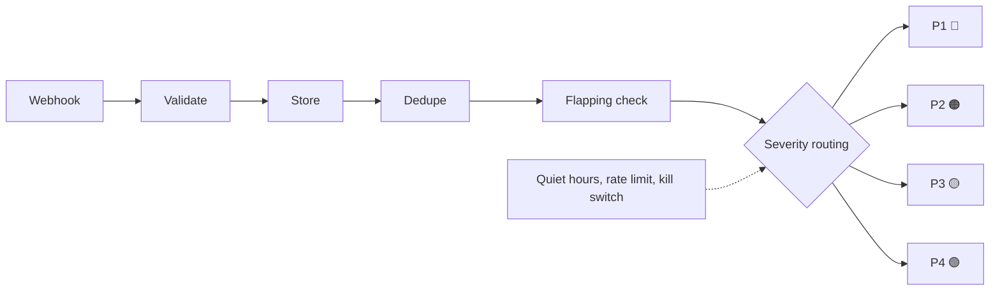
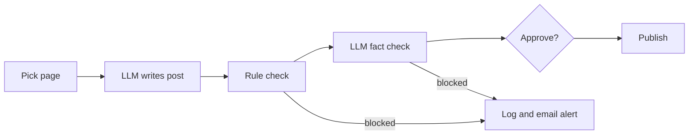

<div align="center">


[](https://parkaviautomation.com)
[](https://linkedin.com/in/parkavi-53136242a)

</div>

```text
$ whoami
parkavi — AI Automation Engineer

$ status
building  → telemetry alert pipelines, LLM workflows
learning  → LiteLLM gateway, GCP server deployment
open to   → AI automation · n8n · DevOps · technical operations roles
```

## 🛠️ Tech Stack

<p align="center">
  
</p>

| Area | Tools |
|---|---|
| Automation | n8n, webhooks, REST APIs, JSON |
| AI | Claude API, LLM workflows |
| Data | Supabase, PostgreSQL |
| Code | Python, JavaScript |
| Ops | Docker, Linux, Git, GitHub |

## ⚡ How I think about automation



Every alert is stored before it is sent, and noisy repeats are filtered out, so people only see what matters.

## 🛡️ How I keep AI posts safe



Two layers check every AI-written post, and a blocked post is logged instead of published.

## 🚀 Projects

| | Project | What it does |
|---|---|---|
| 🛰️ | **Telemetry-n8n** *(private, company repo)* | 30+ node n8n pipeline: deduplication, flapping detection, suppression, P1–P4 routing |
| 📈 | **WTF-SKORE** *(private)* | Claude-written equity research reports with live market data and an approve/reject email step |
| ♾️ | **infinityxz-n8n-workflows** *(private)* | Client automation: brief delivery, re-engagement, weekly digest |
| ⓕ | [placidway-daily-facebook-post](https://github.com/Parkavi111/placidway-daily-facebook-post) | n8n workflow: AI-written daily Facebook post with two-layer guardrails and an approval option |
| 🚗 | [veloce-thar-concierge](https://github.com/Parkavi111/veloce-thar-concierge) ([live demo](https://parkavi111.github.io/veloce-thar-concierge/)) | Concept showroom site with an AI concierge |
| 🧭 | [nextstep-wellbeing-compass](https://github.com/Parkavi111/nextstep-wellbeing-compass) | 4-question app that suggests one gentle next step, with hard-coded safety rules (demo, fictional data) |
| 🤖 | **arop** *(private)* | Flask app that manages simulated robots: tasks, auto-assignment, dashboard and 78 tests |
| 💼 | **linkedin-outreach-ai-improved** *(private)* | Chrome extension that writes LinkedIn messages. I added a connection note length limit and a live character counter |

<details>
<summary><b>More about arop</b></summary>

- Flask and SQLite
- Light and heavy robots, task priorities, manual and automatic assignment
- Simulation with battery drain and charging
- Admin login with CSRF protection
- 78 passing tests (as stated in its README)

</details>

## 🧪 Current Focus
- Telemetry alert pipelines
- LLM workflows
- LiteLLM gateway
- GCP server deployment

<div align="center">


</div>
